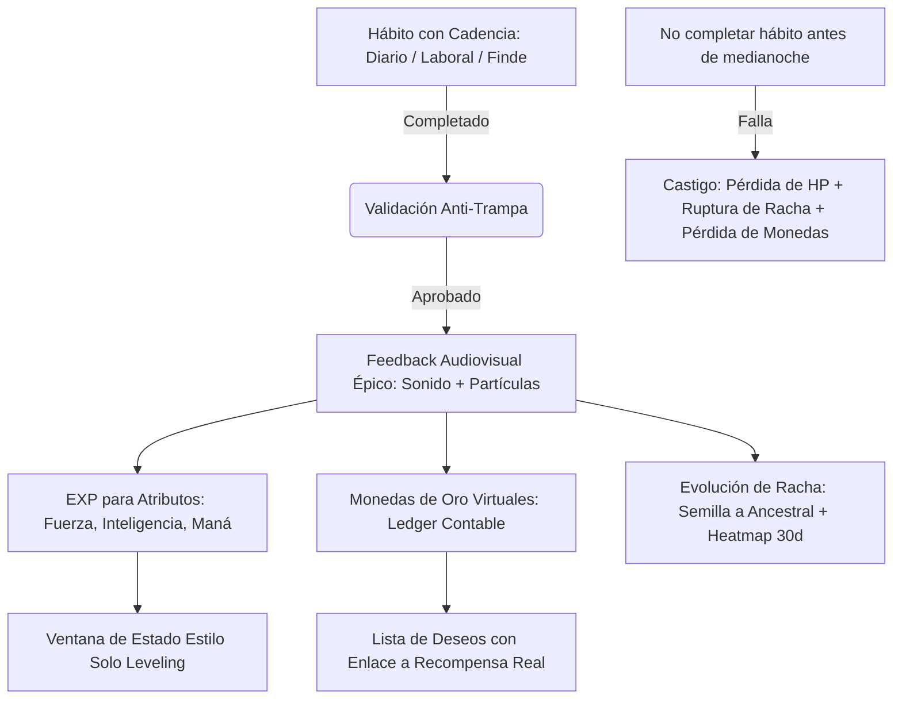

# 🎮 Bitácora Maestra: Análisis de Repositorios de Gamificación

Documento central de evaluación de repositorios y proyectos de código abierto sobre **gamificación de la vida real y seguimiento de hábitos**. Aquí se extrae la lógica, los gatillos mentales psicológicos, lo rescatable para **Rastro Hábitos** y las razones por las cuales se descartan o adoptan ideas.

---

## 📊 Matriz Comparativa Rápida

| Repositorio | Enfoque Central | Economía (Monedas / Tienda) | Castigo / Aversión a la Pérdida | Gatillos Psicológicos Clave | Veredicto |
| :--- | :--- | :--- | :--- | :--- | :--- |
| **01. HabitTrove** | Hábito $\rightarrow$ Monedas $\rightarrow$ Lista de Deseos (vida real) | ✅ **Excelente** (Monedas, contabilidad/ledger, wishlist con link) | ❌ Nulo (solo reversión si desmarcas) | Refuerzo positivo tangible, visualización de meta deseada | **Aprobada la economía**. Extraída a doc técnico y descartado el repo por UI austera. |
| **02. StatusWindow** | Actividad $\rightarrow$ EXP $\rightarrow$ Atributos (STR/INT/MP) $\rightarrow$ Orbe de Habilidades | ❌ Nulo (solo EXP y puntos de habilidad virtuales) | ❌ Nulo (no hay pérdida de HP ni penalización) | Fantasía de poder (*Solo Leveling*), feedback audiovisual, validación anti-trampa | **Aprobada la UI y anti-trampa**. Descartado el bucle de juego por desconexión con la vida real. |
| **03. LifeOS** | "Sistema operativo de vida" todo en uno (Hábitos, Finanzas, Salud, Tareas, RPG, IA) | ⚠️ Indirecto (módulo de finanzas reales de ingresos/gastos, sin monedas gamificadas) | ❌ Nulo (sin daño por procrastinación ni penalización severa) | Identidad RPG, cadencia de hábitos, mapa de calor de 30 días, evolución botánica de rachas | **Aprobada la cadencia de hábitos, el mapa de calor, finanzas y evolución botánica**. Descartado por sobrecomplejidad y saturación de tutoriales. |

---

## 🔎 Análisis Detallado por Repositorio

---

### 1. HabitTrove (`dohsimpson/HabitTrove`)

* **Concepto:** Un gestor de hábitos y tareas donde completar acciones otorga monedas que se acumulan para desbloquear premios de una Lista de Deseos creada por el propio usuario (con enlace a la compra o experiencia real).
* **Stack:** Next.js, React, TailwindCSS.

#### 💡 Lo Rescatable (Para robar/implementar en Rastro):
1. **Economía de Monedas con Contabilidad Real (Ledger):** Cada moneda ganada o gastada no es un simple número que sube o baja; queda asentada en un historial de transacciones con fecha, tipo y referencia.
2. **Reversibilidad Anti-Explotación (`UNDO`):** Si el usuario desmarca un hábito completado por error o trampa, el sistema descuenta automáticamente las monedas otorgadas mediante una transacción negativa.
3. **Lista de Deseos Conectada a la Vida Real:** Poder configurar ítems con costo en monedas y una **URL externa** (ej. un link de Amazon, una reserva para cenar, un juego en Steam). Esto ancla la disciplina a una gratificación tangible.
4. **Límites de Canje:** Las recompensas pueden tener un stock finito (`targetCompletions`) que se agota al canjearse.

#### 🧠 Gatillos Mentales que Activa:
* **Refuerzo Contingente (Dopamina con Propósito):** El cerebro asocia el esfuerzo inmediato (hacer 30 min de ejercicio) con un paso concreto hacia algo deseado (comprarse unos auriculares).
* **Teoría del Establecimiento de Metas (Locke & Latham):** Saber exactamente cuánto "cuesta" tu próximo premio y ver la barra acercarse reduce la procrastinación.

#### ❌ Por qué se descartó el resto del repositorio:
* Interfaz gráfica simple, sin emoción ni inmersión.
* No tiene elementos de RPG (sin niveles, sin avatar, sin estadísticas de personaje).
* Sin castigo ni costo por procrastinar (si no haces el hábito, simplemente no ganas monedas, pero no pierdes nada).
* *Documento de detalle técnico:* [`HabitTroveMonedasLogica.md`](./HabitTroveMonedasLogica.md).

---

### 2. StatusWindow (`Deratheone/statuswindow`)

* **Concepto:** Una "Ventana de Estado" inspirada en el manhwa *Solo Leveling*. El usuario responde un cuestionario de bienvenida para definir su clase (Guerrero, Sabio, Místico, Aventurero) y atributos iniciales, y luego registra actividades cotidianas para subir sus estadísticas.
* **Stack:** Next.js (App Router), Framer Motion, Recharts, Lucide Icons, Web Audio API.

#### 💡 Lo Rescatable (Para robar/implementar en Rastro):
1. **Estética Visual de Ventana de Estado (Manhwa / Solo Leveling):**
   * Tarjetas translúcidas con efecto de cristal oscuro (*glassmorphism*), bordes neón azul/violeta y tipografía futurista.
   * Visualización inmediata de estadísticas con barras de progreso animadas.
2. **Modal de Verificación Anti-Trampa (`activity-verification.tsx`):**
   * Al registrar una actividad, no basta con tocar un botón: se abre un modal con preguntas reflexivas (*"¿Qué hiciste específicamente?"*, *"¿Qué aprendiste o cómo te sentiste?"*).
   * Obliga a una pausa consciente de rendición de cuentas, evitando que el usuario marque hábitos en piloto automático.
3. **Feedback Audiovisual Inmediato (`AudioSettings.tsx` + Web Audio API):**
   * Efectos sonoros específicos para cada acción: ganancia de EXP, subida de nivel, clic en interfaz, registro completado.
   * El sonido inmediato eleva el impacto dopaminérgico de completar una tarea en un 200%.
4. **División de Atributos de Vida en 3 Pilares:**
   * **Fuerza (STR):** Cuerpo, cardio, gimnasio, nutrición, resistencia física.
   * **Inteligencia (INT):** Mente, lectura, estudio, programación, trabajo profundo.
   * **Maná (MP):** Consciencia, meditación, higiene de sueño, salud emocional, relaciones.
5. **Efectos de Celebración de Nivel (`celebration-effect.tsx`):**
   * Al subir de nivel, partículas animadas y banner flotante con animación en pantalla completa.

#### 🧠 Gatillos Mentales que Activa:
* **Identidad de Avatar y Narrativa Personal:** Transforma la aburrida "rutina diaria" en la construcción de un personaje épico ("soy un protagonista subiendo de nivel").
* **Feedback Inmediato (Game Loop Clásico):** Ver subir números y escuchar el sonido de subida de nivel tras terminar una sesión de estudio.
* **Pausa Reflexiva:** El formulario cualitativo rompe el autoengaño.

#### ❌ Por qué NO convence como sistema definitivo (Falla Psicológica):
* **Falta Total de Economía:** No hay dinero ni monedas. Subir una barra abstracta de "Maná" se vuelve irrelevante a los 7 días porque no hay premio real.
* **Misiones Procedurales Desconectadas:** El sistema inventa misiones automáticas en vez de ser el rastreador de **tus hábitos concretos y reales** del día.
* **Habilidades Ficticias Inútiles:** El "Orbe de Habilidad" (gacha) desbloquea cartitas con nombres como *"Búho Nocturno"* o *"Cuerpo de Hierro"*, que no otorgan ninguna ventaja en la vida real.
* **Cero Aversión a la Pérdida:** No hay vida (HP) que perder, no hay jefes a los que enfrentar ni riesgo de romper rachas.

---

### 3. LifeOS (`lifeos-app/lifeos`)

* **Concepto:** Una suite integral todo-en-uno ("Life Operating System") que reúne calendario, tareas, hábitos, finanzas, métricas de salud, diario, IA y un minimundo RPG con clases.
* **Stack:** Vite, React 19, TypeScript, TailwindCSS v4, Zustand, Python Flask (backend local SQLite).

#### 💡 Lo Rescatable (Para robar/implementar en Rastro):
1. **Cadencia y Frecuencia de Hábitos (Realismo Psicológico):**
   * Separación clara entre hábitos **Diarios**, **Días laborales (Lunes a Viernes)**, **Fines de semana** y **Semanales**.
   * *Impacto en UX:* Destruye la "culpa de fin de semana" (no penaliza un hábito laboral el sábado o domingo).
2. **Visualización de Hábitos y Estadísticas de Racha:**
   * **Mapa de calor de 30 días (*Heatmap* estilo GitHub)** para cada hábito individual, mostrando intensidad (0 = no hecho, 1 = parcial, 2 = completo).
   * **Insignia de "Semana Perfecta"** (insignia con brillo para hábitos con 7/7 días completados).
   * Visualización simultánea de: Tasa de cumplimiento (%), Racha actual vs. Mejor racha histórica, y total de registros.
3. **Metáfora Botánica / Evolución Orgánica de Rachas:**
   * A medida que la racha avanza en hitos (1, 3, 7, 21, 50 días), la planta evoluciona visualmente: *Semilla $\rightarrow$ Brote $\rightarrow$ Joven $\rightarrow$ Madura $\rightarrow$ Próspera $\rightarrow$ Ancestral*. Brinda un sentido de cultivo y cuidado continuo.
4. **Módulo de Finanzas Personales Limpio:**
   * Registro simple de ingresos y gastos con flujo de caja neto mensual (`Net Cashflow = Ingresos - Gastos`).
   * Alertas de facturas pendientes con cálculo de días hasta el vencimiento (`X días vencido` / `Hoy`).
5. **Cálculo Derivado de Atributos del Personaje (`deriveStats`):**
   * Las estadísticas no se suben inventando números; se derivan automáticamente de la actividad real: Salud (del sueño/ejercicio), Productividad (de tareas), Constancia (del promedio de rachas de hábitos).

#### ❌ Por qué NO convence como producto para el usuario final (La Trampa de la Sobrecomplejidad):
* **"Completo $\neq$ Complejo":** Quisieron meter 10 aplicaciones en una (Notion + Trello + MyFitnessPal + Duolingo + RPG Maker). El usuario se pierde en un laberinto de navegación.
* **Saturación de Tutoriales (*Spotlight Tours* everywhere):** Tener tutoriales y modales explicativos en cada esquina es el síntoma definitivo de una **interfaz poco intuitiva**. Una app de hábitos debe entenderse en 3 segundos sin leer un manual.
* **Módulos de Relleno que Diluyen el Foco:** Secciones como "Lecciones", "Replicador de piezas" o mini-historias desconectadas aburren y distraen del objetivo principal: **construir disciplina diaria**.

---

## 🧬 La Fórmula Perfecta para "Rastro Hábitos"

De la combinación de estos proyectos surge con claridad la arquitectura que buscamos construir:

### Elementos que adoptamos de esta etapa:
1. **De HabitTrove:** El sistema contable de monedas (`CoinTransaction`), reversibilidad (`UNDO`), y la Lista de Deseos (`Wishlist`) con costo y enlaces web reales.
2. **De StatusWindow:** La estética de Ventana de Estado flotante (*Solo Leveling*), la división Fuerza / Inteligencia / Maná, el modal de verificación cualitativa y la retroalimentación por audio.
3. **De LifeOS:** La cadencia de hábitos (diario, días laborales, fines de semana), el mapa de calor de 30 días, la insignia de semana perfecta, la evolución orgánica de rachas y el control de finanzas básicas.
4. **El ingrediente faltante para los próximos candidatos:** **Aversión a la pérdida y penalización real** (sistema de Salud / HP, jefes de hábitos, penalizaciones por fallar y protección de rachas).

---

## 📝 Próximos Candidatos a Evaluar en la Lista

- [x] **`dohsimpson/HabitTrove`** (Analizado y extraído a doc).
- [x] **`Deratheone/statuswindow`** (Analizado y documentado).
- [x] **`lifeos-app/lifeos`** (Analizado y documentado).
- [ ] **`DavidZerox8/TaskMaster`** (Gestión de tareas y misiones RPG).
- [ ] **`redpangilinan/iotawise`** / **`daya0576/beaverhabits`** (Referentes de UX minimalista y mapas de calor de rachas).
- [ ] **`HabitRPG/habitica`** (El referente histórico de pérdida de HP y combate por hábitos).
